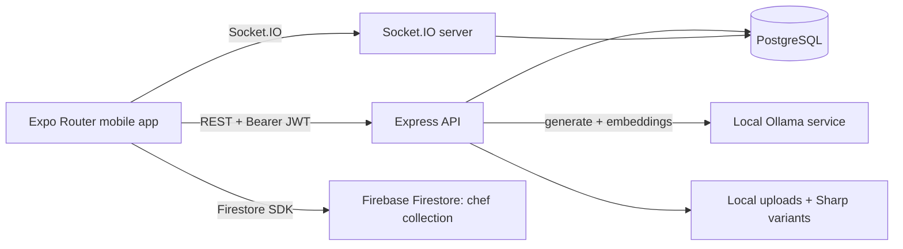

# AI Chef Marketplace

AI Chef Marketplace is a portfolio application that pairs an Expo/React Native client with a TypeScript and Express API. It demonstrates mobile UI and routing, a Redux cart, JWT-based API access, PostgreSQL-backed chefs, foods and orders, Firestore chef data, Socket.IO updates, and two Ollama-backed food experiences. The repository is a work in progress; the current implementation and its limitations are described below.

## Features

- Expo Router screens for authentication, chef and food details, a marketplace home, cart, and AI Chef search.
- Redux Toolkit cart with quantity changes, item removal, and checkout request.
- Node API registration/login, one-hour access JWTs, seven-day refresh JWTs, and access/refresh token storage using Expo SecureStore.
- PostgreSQL-backed chef and available-food listings, user orders, and an experimental semantic food search.
- Firebase Firestore listener for the separate `chef` collection.
- Socket.IO broadcasts of the PostgreSQL chef list when a client connects and after chef mutations.
- Ollama text suggestions and planner-plus-embedding search; Sharp-based image resizing is implemented in the backend media flow.
- Dockerfile for building and running the API container.

## Technology

| Area | Implementation |
| --- | --- |
| Mobile | React Native 0.86, Expo SDK 57, Expo Router, TypeScript |
| State | Redux Toolkit and React Redux |
| API | Node.js, Express 5, TypeScript, REST, Socket.IO |
| Persistence | PostgreSQL (`pg`); Firestore via Firebase JS SDK |
| Authentication | `bcrypt`, `jsonwebtoken`, Expo SecureStore |
| AI and search | Ollama generate and embeddings APIs; PostgreSQL `vector` column |
| Media | Multer, `file-type`, Sharp |
| Tests | Jest / `jest-expo`, Supertest on backend |
| Packaging | Dockerfile for backend; no Compose file |

## Architecture



The mobile client uses a native-platform URL constant in `src/services/api.ts` (`localhost` on iOS and `10.0.2.2` on Android emulator). A physical device needs a reachable backend address, and the current client does not expose this as an environment setting. Firestore and the PostgreSQL API are separate chef data sources. The screen subscribes to both; do not assume they are synchronized.

## Project layout

```text
src/
  app/                  Expo Router screens and layouts
  components/           Shared UI components
  hooks/                Theme and color-scheme hooks
  services/             REST, Firebase, and Socket.IO clients
  store/                Redux store and cart slice
  constants/            Theme constants
ai-chef-backend/
  app.ts, server.ts      Express app and HTTP/Socket.IO startup
  routes/               Auth, chef, food, order, AI, and media routes
  routes/middleware/    JWT and upload middleware
  services/             Food planning/search, embeddings, image processing
  migrations/            Reviewed SQL changes (manual application)
  scripts/               Search calibration script
  __tests__/             Backend Jest/Supertest tests
__tests__/               Frontend Jest tests
assets/                  Local images and app assets
```

Important entry points are `src/app/_layout.tsx`, `src/store/store.ts`, `ai-chef-backend/app.ts`, and `ai-chef-backend/server.ts`. Backend route handlers currently combine request validation, SQL access, and response handling; there is no separate controller/repository layer.

## Key workflows

### Authentication and API access

`src/app/login.tsx` calls `src/services/authApi.ts`. `POST /auth/login` verifies the password with bcrypt and returns an access JWT (1 hour) plus a refresh JWT (7 days). The screen stores both in SecureStore. `src/services/api.ts` adds the access token to protected requests and, after a 401, calls `POST /auth/refresh`, stores the new access token, and retries once. The refresh token is not rotated or revoked, and refresh calls are not coordinated across simultaneous requests. Registration is `POST /auth/register`; it hashes passwords with bcrypt cost 12.

### Marketplace, cart, and orders

`src/app/(tabs)/index.tsx` fetches `/chefs` and `/foods`, subscribes to the Firestore `chef` collection, and connects to `chefUpdate` Socket.IO events. Food cards route to `src/app/food-details.tsx`; adding an item dispatches to `src/store/cartSlice.ts`. The cart calls `POST /orders` through `src/services/orderApi.ts` and clears the local cart when successful.

The current order payload contains only `customer_name` and `total_amount`; the authenticated user ID is derived by the backend. The total is accepted from the client, and cart line items are not persisted. The UI currently supplies a fixed customer name. This is a checkout demonstration, not a complete order or payment workflow. `PATCH /orders/:id/status` allows the owning customer to cancel a pending order.

### AI-powered search

The AI Chef screen calls `POST /foods/search` in `src/services/foodSearchApi.ts`. It is protected by JWT authentication and accepts a 1–500 character query. In `foodSearchPlannerService.ts`, Ollama receives a constrained JSON-planning prompt and returns search intent, food types, matching and similar terms, expected ingredients, excluded ingredients, and a description. The response is parsed and validated, with bounded list sizes and string lengths.

`foodSearchService.ts` embeds planned concepts through Ollama's embeddings endpoint, then queries available foods in PostgreSQL using parameterized SQL, ingredient checks, and pgvector cosine distance. It separates requested matches from similar suggestions, pages each result group, and keeps short-lived per-user search results in a bounded in-memory cache. Food creation also generates a 768-value embedding. This search is experimental: the route uses a hard-coded cosine-distance threshold of `0.20`; relevance depends on the model, curated food data, and threshold calibration. Migration `001_add_food_search_columns.sql` adds `ingredients` and `embedding vector(768)` to an existing `public.foods` table, but creates no vector index and does not populate old records.

There is a second, simpler feature: `POST /ai/suggest` sends an ingredient string to Ollama and returns generated text. It is limited to 10 requests per 15 minutes per rate-limit key and has a 120-second upstream timeout. Its output is plain text, not validated structured data, and it does not search the food catalogue.

### Real-time and database behavior

The Socket.IO server emits the complete PostgreSQL chef list on every connection and after chef create/update/delete operations. The event is `chefUpdate`; there are no order events. Firestore uses `onSnapshot` independently for its `chef` collection. PostgreSQL connection pooling is configured in `ai-chef-backend/db.ts`.

The repository does not include a complete database schema or seed data. The migration assumes existing `public.foods` and a PostgreSQL installation with the `vector` extension. Create and provision the base tables (`users`, `chefs`, `foods`, `orders`, and `media`) using your own reviewed schema before using these routes. SQL migration files are applied manually; there is no migration runner.

## API overview

Base URL in local development: `http://localhost:3000`. Protected routes require `Authorization: Bearer <access-token>`.

| Method | Path | Access | Purpose |
| --- | --- | --- | --- |
| GET | `/health` | Public | API health |
| GET | `/health/db` | Public | PostgreSQL connectivity check |
| POST | `/auth/register` | Public | Register a user |
| POST | `/auth/login` | Public | Login and receive access/refresh JWTs |
| POST | `/auth/refresh` | Public | Issue a new access JWT |
| GET | `/chefs`, `/chefs/:id` | JWT | Read PostgreSQL chefs |
| POST | `/chefs` | JWT | Create a chef |
| PUT/PATCH/DELETE | `/chefs/:id` | **Currently public** | Mutate a chef |
| GET | `/foods` | JWT | List available foods with chef names |
| POST | `/foods` | JWT | Create a food and generate an embedding |
| POST | `/foods/search` | JWT | Start a search or request result pages |
| GET | `/orders`, `/orders/:id` | JWT; owner-scoped | Read the caller's orders |
| POST | `/orders` | JWT | Create an order from customer name and client total |
| PATCH | `/orders/:id/status` | JWT; owner-scoped | Cancel a pending order |
| POST | `/ai/suggest` | JWT + rate limit | Generate ingredient-based text suggestions |
| POST | `/media/upload` | **Currently public** | Upload an image and record resized variants |

The chef mutation and media upload access labels reflect the current middleware wiring, not a recommended security policy. The media route writes to a local `uploads/` directory and stores paths in PostgreSQL; it is not an object-storage delivery system.

## Local setup

Requirements: Node.js/npm, PostgreSQL with the `vector` extension, Ollama with the configured text and embedding models, and Docker only if you want to run the API in a container. Install frontend and backend dependencies separately:

```bash
npm ci
cd ai-chef-backend
npm ci
```

Create `ai-chef-backend/.env` with local values (never commit it):

```dotenv
JWT_SECRET=<long-random-secret>
DB_HOST=localhost
DB_PORT=5432
DB_NAME=<database-name>
DB_USER=<database-user>
DB_PASSWORD=<database-password>
OLLAMA_URL=http://localhost:11434
OLLAMA_MODEL=<installed-generation-model>
OLLAMA_EMBEDDING_MODEL=nomic-embed-text
```

`JWT_SECRET`, `OLLAMA_URL`, and `OLLAMA_MODEL` are required by `config.ts`; the database variables are read by `db.ts`. Configure the PostgreSQL schema and extension first, and apply the food search migration only where appropriate. The app does not automatically run migrations or seed records.

Start the API from `ai-chef-backend/`:

```bash
npm run dev
```

Start the Expo app from the repository root in another terminal:

```bash
npx expo start
```

The frontend's local API and Socket.IO addresses are hard-coded in service files. Adjust the development network configuration for a physical device or a non-local server. Firebase Firestore also needs a configured project and suitable Firestore rules; its client configuration is in `src/services/firebaseConfig.ts`.

### Docker

The backend Dockerfile builds the TypeScript service and exposes port 3000. It does not provision PostgreSQL, Ollama, schema, or persistent media storage. Supply backend environment values and ensure container networking can reach those services. For example, from `ai-chef-backend/`:

```bash
docker build -t ai-chef-backend .
docker run --rm -p 3000:3000 --env-file .env ai-chef-backend
```

There is no Docker Compose configuration. The sample command alone is not a production deployment recipe.

## Tests and checks

Tests are present in root `__tests__/` and `ai-chef-backend/__tests__/`. They cover selected screens/services and backend auth, routes, planner, embeddings, and search behavior. No coverage percentage is claimed here. Run the suites with:

```bash
# repository root
npm test

# backend
cd ai-chef-backend
npm test
```

Static checks are configured in the frontend package as `npm run lint`; backend has `npm run build`. These commands have not been run for this README review.

## Security and production readiness

- JWT secrets are required at backend startup and must be strong, private deployment values. Access and refresh tokens use the same secret; refresh rotation, revocation, and logout invalidation are not implemented.
- Password hashes use bcrypt. SQL statements shown in the routes use parameterized values, but query safety alone does not provide authorization.
- Chef `PUT`, `PATCH`, and `DELETE`, plus `/media/upload`, currently lack authentication. Chef create requires any valid JWT, without a role/ownership model. Socket.IO accepts wildcard origins and does not authenticate connections.
- CORS is unrestricted, there is no general API rate limit, and request validation is hand-written. Only `/ai/suggest` has an Express rate limiter; food search can invoke multiple expensive Ollama operations and has no route-level limiter.
- The cart/order flow trusts a client-supplied total and does not persist item/price snapshots. A production order API must calculate totals from trusted database prices and validate availability within a transaction.
- Media uploads use a local disk path, accept a MIME-filtered upload followed by file signature checks, and do not require authentication. Persistent storage, cleanup on all failure paths, and delivery URLs need production design.
- Errors generally return generic API messages, but logs use `console` and there is no structured logging, monitoring, or audit trail. The backend closes its pool on SIGINT; startup readiness and graceful handling of other termination signals need attention.
- Firebase client settings are bundled into the app. Firebase API keys are identifiers rather than server secrets, but Firestore security must rely on correctly configured rules; do not place privileged credentials in the client.
- Frontend API calls use plain HTTP local addresses. Production transport security and configurable API origins are not implemented.

## Current limitations and next steps

The project demonstrates several end-to-end concepts, but it is not production-ready. Priority improvements before a portfolio showcase:

1. **P0:** Protect chef mutation and media routes; remove or gate unrestricted Socket.IO access; secure Firebase rules and remove debug logging that reveals application data.
2. **P0:** Rework checkout so the server accepts item IDs and quantities, computes prices, and persists order lines transactionally. Do not present client-total checkout as production order processing.
3. **P1:** Add and document the canonical schema, seed/development data, and repeatable migration workflow; the repository only contains an additive food-search migration.
4. **P1:** Make API/socket base URLs configurable, use HTTPS outside local development, and document the supported device setup.
5. **P1:** Add a shared validation/error layer, role-based authorization, refresh-token rotation/revocation, and route-level rate limits for costly search.
6. **P1:** Calibrate semantic search against a labeled query set; add pgvector indexes and record model/dimension compatibility before scaling.
7. **P2:** Add structured operational logging, health/readiness checks, deployment configuration, and persistence/object storage for uploaded media.

Do not claim payment processing, persisted order items, order real-time updates, production deployment, recommendation accuracy, or comprehensive test coverage: those are not implemented or measured in this repository.

## Screenshots

Screenshots are not included yet. Add current app screenshots here when available; do not use mockups as evidence of implemented screens.

## Author and purpose

**Author:** [SmithaMohan]

**Purpose:** Portfolio project for demonstrating mobile and full-stack implementation, learning, and technical interview discussion.
